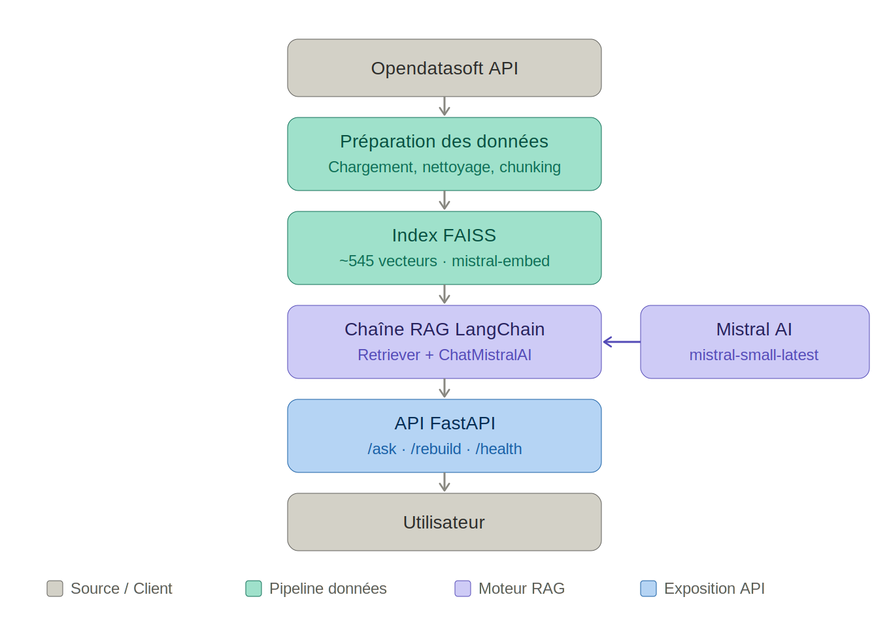

# 🎭 Puls-Events RAG — Chatbot de recommandations culturelles

> POC d'un système de Retrieval-Augmented Generation (RAG) pour recommander des événements culturels dans la région de Grenoble / Isère, développé dans le cadre d'une mission freelance pour **Puls-Events**.

---

## 📋 Contexte

Puls-Events souhaite intégrer un chatbot intelligent capable de répondre aux questions des utilisateurs sur les événements culturels. Ce POC démontre la faisabilité technique d'un pipeline RAG combinant :

- **Retrieval** : recherche sémantique dans une base vectorielle FAISS
- **Augmented Generation** : génération de réponses naturelles via Mistral AI
- **API REST** : exposition du système via FastAPI, avec une interface de chat de démonstration

---

## 🏗️ Architecture



```
Utilisateur (interface /chat ou client HTTP)
    │
    ▼
FastAPI  POST /ask
    │
    ▼
rag/chain.py  ── ask()
    ├── 1. Retrieval  (rag/retriever.py)
    │       ├── Embeddings Mistral (mistral-embed)
    │       ├── Recherche de similarité FAISS (k × 6 candidats)
    │       └── Filtre de date (≤ 2025-12-31) → 6 documents retenus
    ├── 2. Génération  (ministral-8b-2512, prompt anti-hallucination)
    └── 3. Sources extraites des mêmes documents
            ▼
    { question, answer, sources }
            │
            ▼
    👍 / 👎  POST /feedback → data/feedback.jsonl
```

### Stack technique

| Composant | Technologie |
|-----------|-------------|
| LLM | Mistral AI — `ministral-8b-2512` (temperature 0.3, top_p 0.9, max_tokens 1000) |
| Embeddings | Mistral AI — `mistral-embed` |
| Orchestration RAG | LangChain |
| Base vectorielle | FAISS (CPU) |
| API REST | FastAPI + Uvicorn |
| Données | Opendatasoft / OpenAgenda |
| Évaluation | Ragas |
| Tests | pytest |
| Conteneurisation | Docker |
| Gestion dépendances | uv |

---

## 📁 Structure du projet

```
puls-events-rag/
├── .env                        # Clé API Mistral (non versionné)
├── .gitignore
├── README.md
├── pyproject.toml              # Dépendances (uv)
├── uv.lock
├── dockerfile
├── rapport_technique.md        # Rapport technique du POC
├── architecture_puls_events.png
│
├── data/
│   ├── raw/                    # Données brutes OpenAgenda (ignoré par git)
│   ├── processed/
│   │   └── events_clean.csv    # Événements nettoyés, prêts à indexer
│   └── feedback.jsonl          # Retours 👍/👎 des utilisateurs (ignoré par git)
│
├── index/                      # Index FAISS sauvegardé (ignoré par git)
│
├── scripts/
│   ├── collect_data.py         # Collecte + nettoyage via l'API Opendatasoft
│   ├── build_index.py          # Découpage, vectorisation et indexation FAISS
│   ├── check_index.py          # Contrôle de cohérence CSV ↔ index FAISS
│   └── evaluate_ragas.py       # Évaluation automatique Ragas
│
├── rag/
│   ├── retriever.py            # Chargement de l'index et recherche sémantique
│   └── chain.py                # Chaîne RAG (retrieval + génération Mistral)
│
├── api/
│   └── main.py                 # API FastAPI (v0.2.0) + interface de chat /chat
│
├── tests/
│   ├── test_data.py            # Tests collecte et nettoyage
│   ├── test_index.py           # Tests indexation FAISS
│   └── test_api.py             # Tests API REST (RAG mocké)
│
└── docs/
    ├── qa_dataset.json                   # Jeu de test annoté (questions / réponses de référence)
    ├── evaluation_resultsRagas.json      # Résultats Ragas v0.2 (version courante)
    ├── evaluation_resultsRagas.csv
    ├── evaluation_resultsRagas_v0.1.json # Résultats Ragas v0.1 (référence)
    └── evaluation_resultsRagas_v0.1.csv
```

---

## 🚀 Installation et lancement

### Prérequis

- Python ≥ 3.11
- [`uv`](https://docs.astral.sh/uv/) installé
- Une clé API Mistral ([console.mistral.ai](https://console.mistral.ai))

### 1. Cloner le dépôt

```bash
git clone https://github.com/vler0ux/puls-events-rag.git
cd puls-events-rag
```

### 2. Installer les dépendances

```bash
uv sync
```

### 3. Configurer la clé API

Créer un fichier `.env` à la racine :

```bash
MISTRAL_API_KEY=votre_cle_mistral
```

### 4. Collecter les données

```bash
uv run python scripts/collect_data.py
```

Récupère les événements de Grenoble Métropole depuis l'API Opendatasoft (OpenAgenda, aucune clé requise), puis les nettoie : suppression des événements sans description ou avec une description de moins de 5 mots. Produit :
- `data/raw/events_raw.json`
- `data/processed/events_clean.csv` (~500 événements)

### 5. Construire l'index vectoriel

```bash
uv run python scripts/build_index.py
```

Découpe les descriptions en chunks (512 caractères, chevauchement 64), génère les embeddings via `mistral-embed` par lots de 50 et indexe dans FAISS. Produit :
- `index/faiss_index/`

Pour vérifier la cohérence entre le CSV et l'index :

```bash
uv run python scripts/check_index.py
```

### 6. Lancer l'API

```bash
uv run uvicorn api.main:app --reload
```

- API : `http://localhost:8000`
- Documentation Swagger : `http://localhost:8000/docs`
- Interface de chat : `http://localhost:8000/chat`

> L'API vérifie au démarrage que l'index FAISS existe et s'arrête avec un message explicite sinon.

---

## 🐳 Lancement via Docker

L'image embarque `data/processed/` et `index/` : construire l'index (étapes 4 et 5) **avant** le build.

```bash
# Build
docker build -t puls-events-rag .

# Run
docker run -p 8000:8000 --env-file .env puls-events-rag
```

---

## 🔌 Endpoints API

| Méthode | Route | Description |
|---------|-------|-------------|
| `GET` | `/` | Statut de l'API |
| `GET` | `/health` | Endpoint de santé (Docker / monitoring) |
| `POST` | `/ask` | Pose une question au système RAG |
| `POST` | `/rebuild` | Reconstruit l'index FAISS depuis le CSV |
| `POST` | `/feedback` | Enregistre un avis 👍 / 👎 sur une réponse |
| `GET` | `/chat` | Interface web de démonstration du chatbot |

### `POST /ask`

```bash
curl -X POST http://localhost:8000/ask \
  -H "Content-Type: application/json" \
  -d '{"question": "Des concerts de jazz prévus à Grenoble ?"}'
```

Réponse :
```json
{
  "question": "Des concerts de jazz prévus à Grenoble ?",
  "answer": "Voici les concerts de jazz à venir à Grenoble ...",
  "sources": [
    {
      "title": "...",
      "city": "Grenoble",
      "date": "2025-06-21",
      "url": "https://openagenda.com/..."
    }
  ]
}
```

Codes d'erreur :
- `400` : question vide
- `503` : limite de requêtes Mistral atteinte (HTTP 429) malgré les nouvelles tentatives automatiques, réessayer quelques secondes plus tard
- `500` : erreur interne du pipeline RAG

En cas de limite de requêtes Mistral (429), l'API réessaie automatiquement jusqu'à 3 fois, avec une attente de 2 s puis 4 s, avant de renvoyer le `503`.

Si aucun événement pertinent n'est trouvé dans le contexte, le modèle répond « Je n'ai pas trouvé d'événement correspondant… » et suggère d'élargir la recherche ; l'interface `/chat` n'affiche alors pas de sources.

### `POST /rebuild`

Reconstruit l'index vectoriel à partir de `data/processed/events_clean.csv` (renvoie `404` si le CSV est absent).

```bash
curl -X POST http://localhost:8000/rebuild
```

### `POST /feedback`

Enregistre l'avis de l'utilisateur sur une réponse, sous forme d'une ligne JSON horodatée ajoutée à `data/feedback.jsonl`. `rating` vaut `1` (👍) ou `-1` (👎) ; toute autre valeur renvoie `400`.

```bash
curl -X POST http://localhost:8000/feedback \
  -H "Content-Type: application/json" \
  -d '{"question": "Des concerts de jazz prévus ?", "answer": "Voici ...", "rating": 1}'
```

> Avec Docker, ce fichier est écrit dans le conteneur : monter un volume sur `/app/data` pour conserver les retours.

### `GET /chat`

Interface de chat minimaliste : questions d'exemple cliquables, affichage de la réponse et des sources (titre cliquable, date) dédoublonnées, boutons 👍 / 👎 sous chaque réponse (envoyés à `/feedback`).

Tous les contenus affichés (question, réponse du LLM, titres et dates des sources) sont échappés avant insertion dans la page, et seuls les liens `http(s)://` sont rendus cliquables, afin d'éviter toute injection HTML/JS provenant des descriptions OpenAgenda.

---

## 🧪 Tests

```bash
# Tests de collecte et nettoyage des données
uv run pytest tests/test_data.py -v

# Tests d'indexation FAISS (nécessite l'index et la clé API)
uv run pytest tests/test_index.py -v

# Tests de l'API (appels RAG mockés)
uv run pytest tests/test_api.py -v

# Tous les tests
uv run pytest -v
```

Les tests de données vérifient notamment : présence des colonnes requises, descriptions non vides et d'au moins 5 mots, localisation renseignée, événements situés dans la zone de Grenoble.

---

## 📊 Évaluation

Le système est évalué avec **Ragas** sur un jeu de 10 questions/réponses annotées (`docs/qa_dataset.json`) :

```bash
uv run python scripts/evaluate_ragas.py
```

Résultats enregistrés dans `docs/evaluation_resultsRagas.json` (et `.csv`). Les résultats de la v0.1 sont conservés dans `docs/evaluation_resultsRagas_v0.1.json` (et `.csv`).

| Métrique | v0.1 | v0.2 |
|----------|------|------|
| Modèle de génération et juge Ragas | `mistral-small-latest` | `ministral-8b-2512` |
| Faithfulness | 0.84 | 0.74 |
| Context precision | 0.60 | 0.50 |

> Le modèle juge a changé entre les deux versions : les scores ne sont donc pas strictement comparables.

---

## 🗺️ Données

- **Source** : [Opendatasoft / OpenAgenda](https://public.opendatasoft.com/explore/dataset/evenements-publics-openagenda)
- **Zone** : Grenoble Métropole (Grenoble, Échirolles, Meylan, Gières, Saint-Martin-d'Hères, Eybens, Seyssins, Claix)
- **Période collectée** : 12 mois glissants avant et après la date de collecte
- **Filtre à la recherche** : événements débutant au plus tard le 31/12/2025 (`CUTOFF_DATE` dans `rag/chain.py`)
- **Volume** : 513 événements après nettoyage

---

## ⚠️ Limites connues

Points identifiés lors de l'audit du code et non encore traités dans ce POC :

- **Filtre de date figé** : `CUTOFF_DATE = "2025-12-31"` (`rag/chain.py`) sans borne basse ; le chatbot peut recommander des événements déjà passés et ignore ceux de 2026. À remplacer par un filtre relatif à la date du jour, avec des données recollectées.
- **Endpoints non protégés** : `/rebuild` (déclenche des appels d'embeddings facturés) et `/feedback` (taille des champs non limitée) sont accessibles sans authentification.
- **Index rechargé à chaque requête** : `retrieve()` relit l'index FAISS depuis le disque à chaque question.
- **Évaluation Ragas** : les 6 documents récupérés sont passés comme un seul contexte, ce qui rend la context precision binaire par question ; le modèle juge est le même que le modèle de génération.
- **Réponse « aucun résultat »** : détectée côté interface par la sous-chaîne `"pas trouvé d"`, alors que le modèle propose parfois malgré tout des événements.

---

## 📄 Licence

Projet réalisé dans le cadre d'une formation OpenClassrooms. Données événementielles sous licence ouverte OpenAgenda.
